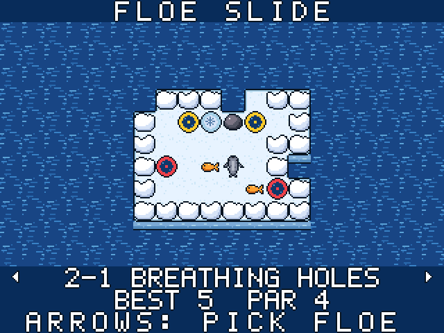
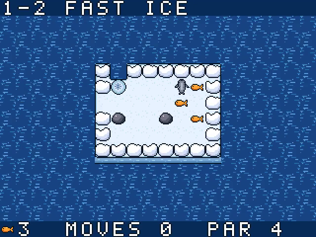
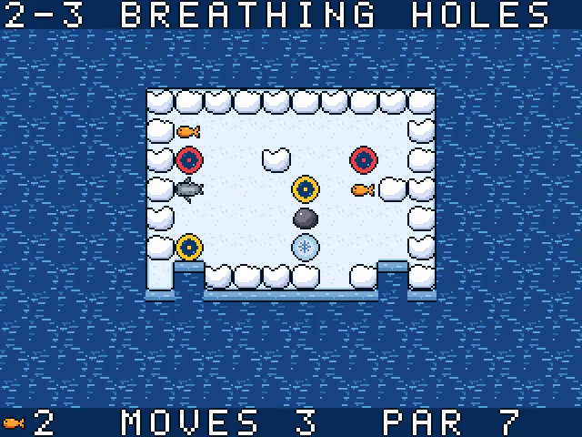

# Floe Slide

Slide across the ice, collect every fish, then reach the exit hole. Solve 32 puzzles across four worlds using snow banks, movable blocks, paired breathing holes and cracked ice.

For the Zeal 8-bit computer with the Video Board, running Zeal 8-bit OS.

  

## Controls

Menu prompts default to a connected SNES pad and follow the last device used
in the menu. The selected keyboard/pad display stays fixed during the game.

| Action | Keyboard | SNES pad |
|---|---|---|
| Slide | arrows | D-pad |
| Undo a move (any number) | Z or Space (or A) | B or Y |
| Restart the floe | X (or S) | A or X |
| Pause | Enter | Start |
| Back to the title | Right Shift (in play, or from pause) | Select |
| Title: pick a floe | Left/Right one floe, Up/Down one world, Enter to play | |

## How to play

- Choose a direction and slide until something stops you.
- Collect all fish before entering the exit. Push blocks to stop yourself or fill water.
- Undo moves freely or restart a floe to try another route.

## Build

Install the Zeal Development Environment (ZDE) and its SDK dependencies, then run
these commands from this repository:

```sh
zde deps install zgdk
zde deps install zar
zde cmake
```

The build produces `bin/floeslide.bin` and `bin/floeslide.zar`.
Use a current ZGDK installation.

## Run

For Zeal-NativeEmulator, mount the output folder as HostFS:

```sh
zeal-native -r /path/to/os_with_romdisk.img -H bin
```

At the ZOS prompt:

```text
cd H:/
exec floeslide.bin
```

On hardware, copy the `.bin` and `.zar` together and run the game from that folder.

Build variants, asset editing and optional development tools are documented in
[the development guide](docs/development.md).

## License

Copyright 2026 David Higgins. Game code and original assets are licensed under
[Apache License 2.0](LICENSE). External SDKs and tools retain their own licenses.
